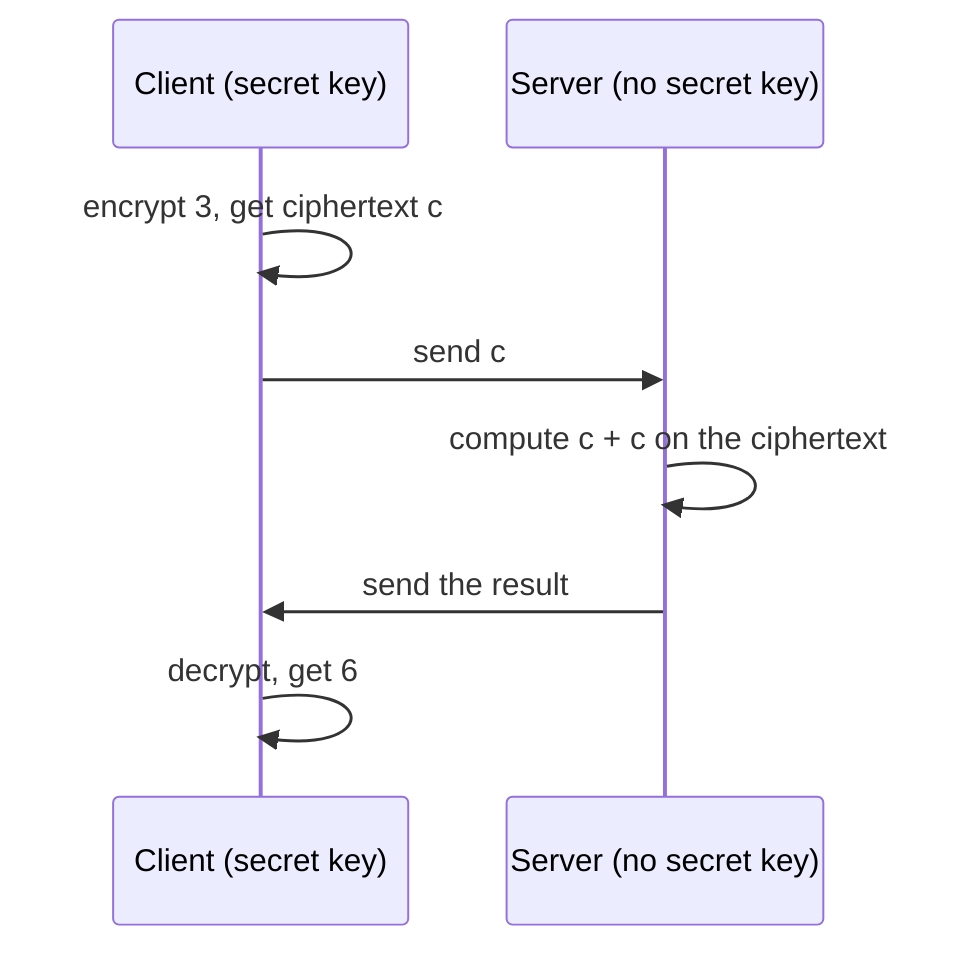

# Homomorphic encryption

Normal encryption protects data at rest and in transit. To compute on it, the server has to decrypt it first, and then the server sees everything. Homomorphic encryption removes that step. The server computes on the ciphertext, and the result, once decrypted by the key holder, equals what the same computation on the plain data would have given.

A small picture helps. The client has the number 3 and wants the server to double it. The client encrypts 3 into a ciphertext, which looks like random bytes. The server adds the ciphertext to itself and never learns what is inside. The client decrypts the result and gets 6.

## Terms used on the other pages

**Plaintext** is the data before encryption. **Ciphertext** is the encrypted form. **Encrypting** and **decrypting** need a key (see [Keys](keys.md)). **Evaluating** means computing on ciphertexts, and it is all the server does.

A server can run additions and multiplications. Everything else is built from those two. A dot product of two vectors is a set of multiplications followed by additions, so a server can score a query against stored vectors without seeing either.

## Why Ombra uses it

A vector database holds embeddings, and an embedding can be inverted to recover much of the text it came from. With homomorphic encryption the server stores and searches vectors, and receives your queries, without holding anything it can read. The server is not trusted with the data. It is trusted only to run the computation.

## What it costs, and what it cannot do

Computing on ciphertexts is slow compared with computing on plain numbers. With the `balanced` preset the ring dimension is {{ preset("balanced", "ring_dim") }}, so a fresh ciphertext is two polynomials of {{ preset("balanced", "ring_dim") }} coefficients over three 64-bit words each: 2 × 3 × 8 × 16384 bytes, about 0.8 MB, for one ciphertext. One multiplication of two such ciphertexts costs far more than multiplying two floats. This is why Ombra runs the server on GPUs and packs thousands of values into each ciphertext (see [CKKS in simple terms](ckks.md)).

Some limits that no setting removes:

- The server cannot compare. It cannot answer "is this score larger than that one" or "is this value equal to 7", because there is no `if` on an encrypted number. Ombra returns encrypted scores to the client, which decrypts them and picks the top results.
- Each multiplication uses part of a fixed budget, so a computation can only go a few multiplications deep. The [CKKS page](ckks.md#levels-and-rescaling) shows why.
- Results are approximate. CKKS works on real numbers and returns them with a small error.

## Fully homomorphic, and what Ombra uses

A scheme is fully homomorphic when it can compute anything, for as long as needed. That needs an expensive refresh step called bootstrapping. Ombra does not bootstrap. It uses CKKS with a fixed depth of {{ preset("balanced", "multiplicative_depth") }} multiplications, which is enough for a dot product and a filter, and is much faster.
