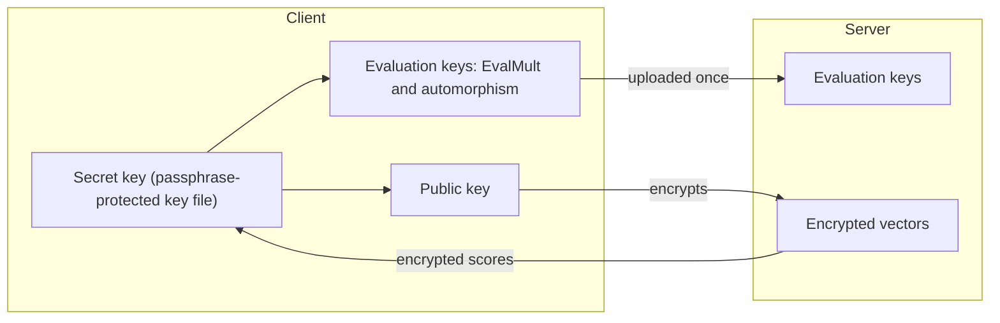

# Keys and who holds them

Ombra uses four kinds of key material. Two never leave the client, and the server gets only what it needs to compute.

| Key | What it does | Who holds it |
| --- | --- | --- |
| Secret key | Decrypts. Every other key is made from it. | Client only |
| Public key | Encrypts. Cannot decrypt. | Client (the server never needs it) |
| Multiplication key (EvalMult key) | Lets the server shrink the product of two ciphertexts back to normal size. | Server, uploaded by the client |
| Automorphism keys | Let the server rotate the slots of a ciphertext. | Server, uploaded by the client |

The last two are called evaluation keys. They are public: having them does not help anyone decrypt. Along with them the client uploads the crypto context, which is the parameter set (ring dimension, moduli) and contains no key.

The secret key is generated on the client and stays there. No message in the server's API has a field that could carry it. On disk the client keeps it in a key file protected by a passphrase. If you lose the key file or the passphrase, nobody can recover your data, Ombra included.

## What the evaluation keys are for

Two operations need help from a key, and both come up in search.

**Relinearization.** A ciphertext holds two polynomials $(c_0, c_1)$ that decrypt as $c_0 + c_1 s$, where $s$ is the secret key. Multiplying two ciphertexts gives three parts $(d_0, d_1, d_2)$ that decrypt as $d_0 + d_1 s + d_2 s^2$. Left alone, every multiplication would make the ciphertext bigger, and the next operation expects two parts. Relinearization folds $d_2$ back into the first two. The multiplication key makes this possible: it is an encryption of $s^2$ under $s$, so the server can do the fold without knowing $s$.

**Automorphisms.** An automorphism rewrites the polynomial inside a ciphertext by replacing $X$ with $X^k$. It is how slots rotate (see [CKKS](ckks.md#slots-and-the-ring)). The result is encrypted under the rewritten key $s(X^k)$ instead of $s(X)$, so it must be switched back, and the automorphism key for that $k$ does it. The client generates one key per rotation the search needs and uploads the set.

Both are cases of **key switching**: turning a ciphertext under one key into a ciphertext under another, with a public key-switching key.

!!! deep-dive "Hybrid key switching and the special modulus"
    Key switching adds noise, and a naive version adds a lot. The hybrid method used by Ombra's presets splits the key into digits and works in a larger modulus $PQ$, where $P$ is an extra special modulus, then divides $P$ back out. The `fast` preset uses {{ preset("fast", "num_large_digits") }} digits. More digits mean less noise but larger keys. The preset fixes this, so there is nothing to tune.

## What the server can learn from the keys

The evaluation keys are encryptions of the secret key's square and of its rewritten forms. Under the hardness assumption behind CKKS they reveal nothing useful about the secret key. What the server can still observe, such as how many ciphertexts it holds and how often you query, is covered in the security section.
