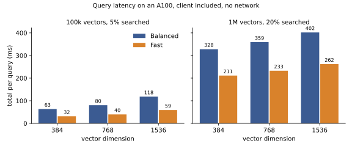

# Latency and throughput

!!! note "Some numbers are pending a new benchmark run on the current code."
    Figures from before the one-tower decrypt, in-place query expansion and seeded storage were removed. The tables marked TBD wait for the next run: the cold cache at 1,000,000 vectors, throughput, and the A10.

Synthetic vectors are used for the speed runs. The server and the client run on the same machine, so the network is not in the times unless a line says otherwise. Latency means the whole query as a user sees it: the client encrypts the query, the server searches, the client decrypts and ranks.

Two names first. Balanced is the default preset (ring dimension {{ preset("balanced", "ring_dim") }}, {{ preset("balanced", "batch_size") }} vectors per ciphertext). Fast is the smaller preset (ring dimension {{ preset("fast", "ring_dim") }}, {{ preset("fast", "batch_size") }} vectors per ciphertext). "Searched" below is the share of the collection the second search stage reads.

## One query on an A100

Total time per query on an A100 (40 GB), by preset, dimension, collection size and share searched. Medians of 20 queries, measured on the current code with `core/bench/e2e.py`. The full grid, including 20% searched at 100,000 and 5% at 1,000,000, is in `docs/charts/latency.csv`.

| Dimension | Collection | Searched | Balanced | Fast |
| --- | --- | --- | --- | --- |
| 384 | 100,000 | 5% | 63.2 ms | 31.5 ms |
| 384 | 1,000,000 | 20% | 327.8 ms | 211.4 ms |
| 768 | 100,000 | 5% | 80.4 ms | 39.6 ms |
| 768 | 1,000,000 | 20% | 359.1 ms | 232.8 ms |
| 1536 | 100,000 | 5% | 118.1 ms | 59.0 ms |
| 1536 | 1,000,000 | 20% | 401.9 ms | 262.1 ms |

The client's decrypt and ranking step grows with the number of blocks searched, so choosing a smaller share to search is the biggest lever on latency. Fast answers in 0.49 to 0.65 of Balanced's time across these cells.

At 1,000,000 vectors, searching 20% instead of 5% costs more time than going from 384 to 1536 dimensions.

Timing varies between runs. The same search kernel took up to 26% longer in one run than in another on the same card. Read each figure here as one sample, not a guarantee.

## The server's share

Time the server spends on one query on an A100, from the same run (medians of 20 queries). This covers reading the query, expansion, both GPU search stages and their downloads.

| Dimension | Collection | Searched | Balanced | Fast |
| --- | --- | --- | --- | --- |
| 384 | 100,000 | 5% | 32.6 ms | 16.2 ms |
| 384 | 100,000 | 20% | 36.9 ms | 16.7 ms |
| 384 | 1,000,000 | 5% | 39.3 ms | 20.4 ms |
| 384 | 1,000,000 | 20% | 48.5 ms | 30.1 ms |
| 768 | 100,000 | 5% | 49.6 ms | 24.1 ms |
| 768 | 100,000 | 20% | 51.6 ms | 25.9 ms |
| 768 | 1,000,000 | 5% | 54.4 ms | 28.4 ms |
| 768 | 1,000,000 | 20% | 80.1 ms | 50.4 ms |
| 1536 | 100,000 | 5% | 87.2 ms | 43.1 ms |
| 1536 | 100,000 | 20% | 91.0 ms | 46.3 ms |
| 1536 | 1,000,000 | 5% | 96.2 ms | 50.5 ms |
| 1536 | 1,000,000 | 20% | 122.3 ms | 80.6 ms |

Most of this is query expansion, which costs about 19 ms at d = 384, 37 ms at 768 and 72 ms at 1536 and does not depend on the collection size. The search itself takes 1 to 35 ms.

## Over gRPC with a real server

The same query through the gRPC API, with the client encrypting in 16 processes, on an A100 40 GB in a container with 32 CPUs. Medians over 30 queries at d = 384, with p95 in brackets.

| Collection | Filter | Balanced | Fast |
| --- | --- | --- | --- |
| 100,000 | none | 143 ms (170 ms) | 59 ms (8.1 s) |
| 100,000 | 2 fields | 143 ms (163 ms) | 59 ms (66 ms) |

A filter is part of the same encrypted search, so it adds no extra round. A query sends 0.79 MB (Balanced) or 0.39 MB (Fast) up and, in this run, gets 3.7 MB (Balanced) or 2.0 MB (Fast) back over both stages. The answer size depends on how many blocks are searched.

The 8.1 s p95 of Fast without a filter comes from a few queries that waited about 8 s for the first answer of the second stage. The median is not affected and the filtered run shows no such wait. We have not found the cause yet.

## What is slow

**A collection larger than the GPU cache.** When the collection does not fit in the GPU and host cache, every probe is read from disk, and the query takes seconds instead of milliseconds. The earlier test, at 1,000,000 vectors with a 24 GB GPU budget and an 8 GB host budget, showed a gap of two orders of magnitude to the cached case. That test ran before seeded storage, which halves the bytes read from disk, so its numbers are removed.

| Collection | Cache | Balanced median | Fast median |
| --- | --- | --- | --- |
| 100,000 | fits | 143 ms | 59 ms |
| 1,000,000 | does not fit | TBD | TBD |

A cold cache with small budgets is the worst case, not what a tuned A100 box would show. Nobody has profiled the disk path yet, so we cannot say whether disk speed, parsing or copies cost the time.

The path from host memory to the GPU runs at 22 to 26 GB/s on the A100's PCIe link, and a search over a collection three times the GPU budget spent about 95% of its time moving data and 5% computing (a synthetic test of the cache). Past the GPU's memory, the link sets the speed.

**Local mode on a CPU.** Local mode runs the server on your CPU in a child process. With 10,000 vectors, 2 clusters and the Fast preset, on a Modal container with 8 CPUs: at d = 384, creating the collection took 19.3 s and a search took 0.75 s at the median; at d = 768, 36.1 s and 1.28 s (`tests/bench_local_mode.py`). A laptop is slower: a Ryzen 5 5600H took 28.3 s and 1.35 s at d = 384. Use local mode for development and small collections, not for serving traffic.

**Strict scans.** Strict reads every cluster. We have not timed a Strict query on its own, so there is no figure for it yet.

## Throughput

| Measure | Result |
| --- | --- |
| One query stream, Balanced, A100, client included | TBD queries per second |
| One query stream, server alone | TBD queries per second |
| Ingest, d = 384, A100 server, 16 client processes, 100,000 vectors | 1,132 (Balanced) and 2,010 (Fast) vectors per second, unseeded |

Sending several queries together helps the search kernel: four queries at once ran 1.75x to 1.78x faster per query than one at a time (A100, kernel only, which the changes above do not affect).

## On an A10

The A10 numbers on filtered queries over real text embeddings (Fast, d = 384, 10,003 vectors in 6 clusters) were measured before the changes above and are TBD until they are rerun. Recall under encryption matched plaintext recall in those runs. The accuracy pages have the numbers.
