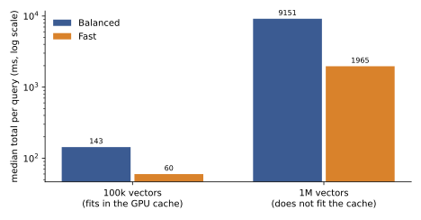

# Latency and throughput

Every number on this page was measured, and the hardware is named next to it. Synthetic vectors were used for the speed runs. The server and the client ran on the same machine, so the network is not in the times unless a line says otherwise. Latency means the whole query as a user sees it: the client encrypts the query, the server searches, the client decrypts and ranks.

Two names first. Balanced is the default preset (ring dimension {{ preset("balanced", "ring_dim") }}, {{ preset("balanced", "batch_size") }} vectors per ciphertext). Fast is the smaller preset (ring dimension {{ preset("fast", "ring_dim") }}, {{ preset("fast", "batch_size") }} vectors per ciphertext). "Searched" below is the share of the collection the second search stage reads.

## One query on an A100

On an A100 (40 GB), a query takes 36 to 414 ms in total, depending on the preset, the dimension, the collection size and how much of it is searched. The table gives the two ends of the range for each dimension.

| Dimension | Collection | Searched | Balanced | Fast |
| --- | --- | --- | --- | --- |
| 384 | 100,000 | 5% | 65.5 ms | 35.6 ms |
| 384 | 1,000,000 | 20% | 333.6 ms | 216.1 ms |
| 768 | 100,000 | 5% | 87.1 ms | 45.7 ms |
| 768 | 1,000,000 | 20% | 370.1 ms | 238.3 ms |
| 1536 | 100,000 | 5% | 130.7 ms | 69.9 ms |
| 1536 | 1,000,000 | 20% | 413.8 ms | 268.5 ms |

Fast answers in 0.52 to 0.65 of Balanced's time in all twelve cases measured, and the gap is widest on small searches.

The server's own share is small. At d = 384, 100,000 vectors, 5% searched, the server takes 34.7 ms of the 65.5 ms on Balanced, and the rest is the client. At 1,000,000 vectors with 20% searched, the server takes 54.2 ms of 333.6 ms. The client's decrypt and ranking step grows with the number of blocks searched: it is 63% to 78% of the total in that large case (Balanced, A100). Choosing a smaller share to search is the biggest lever on latency.

Timing varies between runs. The same search kernel took up to 26% longer in one run than in another on the same card, and a later run of the whole pipeline came out 1.12x to 1.64x slower than an earlier one with the same code. Read each figure here as one sample, not a guarantee.

## Over gRPC with a real server

The same query through the gRPC API, with the client encrypting in 16 processes, on an A100 80 GB. These are medians over 30 queries at d = 384.

| Collection | Filter | Balanced | Fast |
| --- | --- | --- | --- |
| 100,000 | none | 94 ms | 54 ms |
| 100,000 | 2 fields | 92 ms | 54 ms |

A filter costs nothing measurable at this size, because it is part of the same encrypted search. A query sends 0.79 MB (Balanced) or 0.39 MB (Fast) up and gets about 3.7 MB (Balanced) or 2.0 MB (Fast) back across both stages at 100,000 vectors.

## What is slow

**A collection larger than the GPU cache.** At 1,000,000 vectors the collection takes 46 GiB on disk. The test gave the server a 24 GB GPU budget and an 8 GB host budget, so every probe was read from disk. The median query took 16.2 s on Balanced and 8.0 s on Fast without a filter, and the slowest 5% took 54 s and 18 s. The 100,000 vector runs, which fit in the cache, took about 94 ms and 54 ms.

The 1M case is a cold cache with small budgets, so it is the worst case and not what a tuned A100 box would show. Nobody has profiled the disk path yet, so we cannot say yet whether disk speed, parsing or copies cost the time. The filtered runs at 1M varied a lot (4.5 s median on Balanced, 79 ms on Fast) and we have not explained why.

The path from host memory to the GPU runs at 22 to 26 GB/s on the A100's PCIe link, and a search over a collection three times the GPU budget spent about 95% of its time moving data and 5% computing (a synthetic test of the cache). Past the GPU's memory, the link sets the speed.

**Local mode on a CPU.** Local mode runs the server on your CPU in a child process. On a Ryzen 5 5600H laptop with 10,000 vectors and the Fast preset, a search took 2.28 s at d = 384 and 2.71 s at d = 768 on 4 hardware threads, or 1.75 s and 2.18 s on 8. Creating the collection took 42.5 s and 62.9 s on 4 threads. Use local mode for development and small collections, not for serving traffic.

**Strict scans.** Strict reads every cluster. We have not timed a Strict query on its own, so there is no figure for it yet. The 1M rows above show the cost of reading a large share of a collection that does not fit in the cache.

## Throughput

One stream of queries, on an A100 with Balanced, including the client, gave 2.4 to 14.8 queries per second across dimensions 384 to 1536 and collections of 100,000 and 1,000,000 vectors. The server alone, without the client's work, reached 7.6 to 26.6 queries per second. The low end is the 1M, 20%, d = 1536 case.

Sending several queries together helps the search kernel: four queries at once ran 1.75x to 1.78x faster per query than one at a time (A100, kernel only).

Ingest ran at 2,097 to 2,785 vectors per second at d = 384 (A100 server, 16 client processes encrypting). One million vectors took 368 to 386 s to load, and the upload calls are most of that wall time (344 to 351 s). Encryption took 512 to 524 s of CPU time, shared over 16 processes.

## On an A10

On an A10 (4 CPUs) with the Fast preset, d = 384, 10,003 text embeddings in 6 clusters, queries took 70 to 148 ms on average. Filtered queries were faster when the filter let the client skip clusters (70 ms when it narrowed the search to one cluster, 105 ms when all six were read). These are not comparable with the A100 rows above, which used larger collections.

Recall under encryption matched plaintext recall in these runs. The accuracy pages have the numbers.
