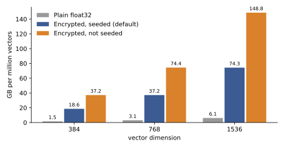

# Storage

Encrypted vectors are large. Each dimension of each vector takes 96 bytes on disk, against 4 bytes for a plain float32. That is 24 times the size, and it is the price of keeping the vectors encrypted during search.

The 96 bytes come from the ciphertext layout. A ciphertext holds one dimension of many vectors, one vector per slot. Balanced has {{ preset("balanced", "batch_size") }} slots per ciphertext and a ring dimension of {{ preset("balanced", "ring_dim") }}. Fast has {{ preset("fast", "batch_size") }} slots and a ring dimension of {{ preset("fast", "ring_dim") }}. Both end up at the same size per vector, because halving the ring halves the slots. For Balanced, a stored ciphertext is 787,423 bytes on disk for 8,192 slots, which is 96.12 bytes per dimension per vector. A measured Fast collection came out at the same size per vector as Balanced (49.0 KB per vector at 1,000,000 vectors, d = 384, both presets).

## Per million vectors

For one million vectors, whole blocks included, an encrypted collection takes:

| Dimension | Encrypted | Plaintext-DB | Plain float32 |
| --- | --- | --- | --- |
| 384 | 37.2 GB | 18.6 GB | 1.5 GB |
| 768 | 74.4 GB | 37.1 GB | 3.1 GB |
| 1536 | 148.8 GB | 74.3 GB | 6.1 GB |

The encrypted size is 24 times the float32 size at every dimension, and Plaintext-DB mode is 12 times.

These figures count the stored column ciphertexts of Balanced, from a measurement of real serialized objects. The encrypted figure rounds up to whole blocks of 8,192 vectors (123 blocks for a million), so it overstates slightly. Plaintext-DB mode is for corpora that any client may read, and its 48 bytes per dimension per vector is the raw size, because serializing a plaintext is not supported by the library we use.

## What a real collection takes

A measured collection takes more than the column ciphertexts alone. With filter fields (two fields of 8 values, which add 16 columns, so 400 columns at d = 384), the data directory held 5.3 GiB for 100,000 vectors on Balanced (57.0 KB per vector) and 45.6 GiB for 1,000,000 (49.0 KB per vector). Fast held 4.6 GiB at 100,000 (49.1 KB per vector) and 45.6 GiB at 1,000,000. The 400 columns alone would be 38.4 KB per vector at 96 bytes each. The measured size is 10 KB above that, and more at 100,000 vectors. Clusters fill their blocks only partly, which would explain the gap and why it shrinks with size, but we did not break it down. Plan for about 50 KB per vector at d = 384 with two small filter fields, and measure your own collection.

## Keys

The server holds public evaluation keys, never the secret key. For Balanced they take:

| Dimension | Rotation keys | Relinearization key | Total |
| --- | --- | --- | --- |
| 384 | 26.2 MB | 2.6 MB | 28.8 MB |
| 768 | 28.8 MB | 2.6 MB | 31.5 MB |
| 1536 | 31.5 MB | 2.6 MB | 34.1 MB |

Fast keys are about 40% smaller. These keys are uploaded once per collection.

## Memory on the GPU

How many vectors fit in the memory of one A100 (40 GB), for Balanced, with 1 GiB left for scratch and one expanded query? This is calculated from the measured object sizes, and nothing was allocated to check it:

| Dimension | Encrypted | Plaintext-DB |
| --- | --- | --- |
| 384 | 1,105,920 | 2,211,840 |
| 768 | 548,864 | 1,097,728 |
| 1536 | 270,336 | 540,672 |

A bigger collection still works. The server keeps the rest on disk and in host memory and pages clusters in as queries ask for them, which is slower. See [latency and throughput](latency-and-throughput.md) for what that costs.
