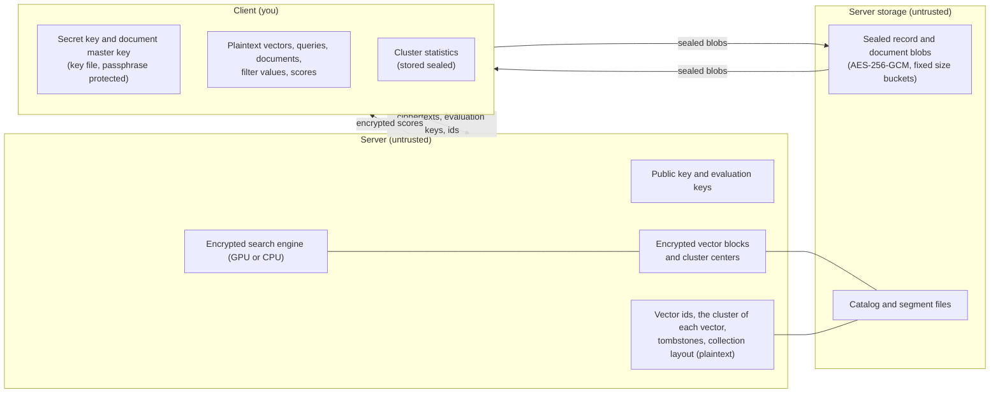

# Threat model

Ombra defends against an honest-but-curious server. That server runs the Ombra software correctly and answers every request, but it tries to learn what it can from everything it stores and sees. This covers a hosting provider, an insider with access to the machine, and an attacker who has broken into it and reads disk, memory and network traffic.

It does not defend against a server that lies. A malicious server can return wrong scores, drop results or serve old data, and the client cannot tell: results have no integrity protection, and the client decrypts whatever it receives after checking the envelope header. That is out of scope, see [Out of scope](out-of-scope.md).

## The parties

The client holds the secret key and every plaintext. It encrypts vectors and queries with the public key, decrypts the scores the server sends back, picks the top k, and re-ranks the best candidates with the exact vectors it gets from the blob store. Clustering also runs on the client, because the server cannot see the vectors. See [Keys](../concepts/keys.md) for what each key does.

The server holds only what the client sends it: ciphertexts, the crypto context and the evaluation keys, ids, and the layout of the collection. Its storage holds the encrypted blocks, the catalog, and the record and document blobs. The client seals records and documents with AES-256-GCM before upload, so the server stores them as opaque bytes of a fixed size class. See [Documents](../how-it-works/documents.md).

## What we assume

- The secret key and the key file stay on the client. No server message has a field for a secret key, and the server never logs one.
- OpenFHE is correct, and the parameters in [Parameters and security level](parameters.md) give at least 128-bit security.
- The network is hostile. The server refuses to start without TLS and without API keys unless you pass `--insecure` or `--no-auth`, and those two flags only work on loopback addresses. API keys have scopes (admin, read, write).
- The server is single-tenant. An API key has a scope, not a collection: any read key reads every collection and blob on the server, and any write key can overwrite or delete data in any of them. Run one server per trust domain.
- The client machine is not compromised. Whoever reads the key file and its passphrase reads everything.

We do not assume the server is physically secure, that its operators are trustworthy, or that its disks and memory are private. Everything the server stores is a ciphertext, a sealed blob, or one of the plaintext items listed in [What the server learns](what-the-server-learns.md).

## What the server knows about records

Ids are chosen by you and stored in plaintext, so never put sensitive data in an id. Every insert also names the cluster of each vector in the clear, so the server knows which ids share a cluster. Neither says what a vector contains, but together with the access patterns they are the main thing the server learns. See [What the server learns](what-the-server-learns.md).

## Search levels

Each collection has a search level, Fast, Decoy or Strict, and a query can override it. The level controls which clusters the server is asked to score, and so how much the cluster choice reveals about a query. The data and the query are encrypted in all three. Decoy and Strict hide only which clusters a query requested. After every search, at every level, the client fetches the record blobs of its best candidates by id. The server knows each id's cluster, so that fetch shows which records were candidates and how large k is. See [Clusters and search levels](../how-it-works/clusters.md) for how each level picks clusters.

There is no plaintext-database mode. Every vector is stored encrypted in every collection, and the client has no setting to store vectors in the clear. Earlier plans described one for public corpora. It is not built, so this documentation describes three modes.

!!! deep-dive "Why there is no formal guarantee for the cluster choices"
    In Fast and Decoy the client decrypts scores and then chooses which clusters to ask for next, so the server sees a function of decrypted values. CKKS decryption is approximate, and decrypted results can leak information about the secret key if they are shown to someone who also holds the ciphertext (the IND-CPA-D setting). Ombra never sends decrypted values to the server, only the cluster ids derived from them. We make no IND-CPA-D claim, and we have not analysed what the ranking of clusters reveals beyond the ids themselves.
